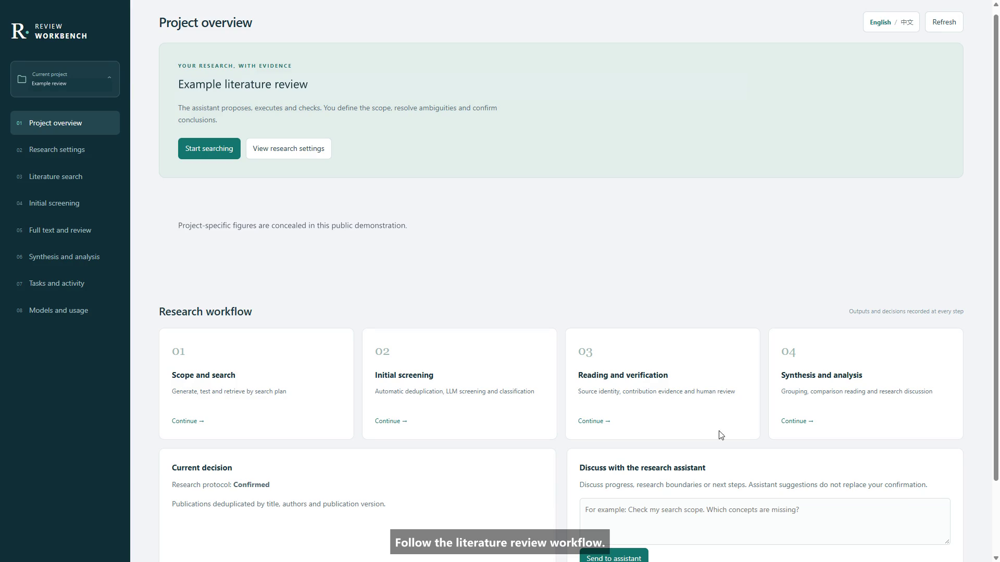

# Review Workbench

Review Workbench is a local application for literature reviews: search, import,
deduplicate, screen, read, summarize and compare publications with AI assistance
and human review. Research questions, criteria, categories and summary fields are
editable for your topic.

## Get started

1. Install and start Docker Desktop with Linux containers, or Docker Engine with Compose.
2. Download the **complete deployment ZIP** from [Releases](https://github.com/quickhdsdc/AgenticDigitalTwin4Manufacturing/releases/latest) and extract it.
3. Copy `.env.example` to `.env` and enter your own model settings. Manual import
   and review work without model credentials.
4. On Windows, double-click **start.cmd**. On Linux or macOS, run **sh start.sh**.
5. Open **http://127.0.0.1:8088**. Stop with **stop.cmd** or **sh stop.sh**.

The ZIP includes a prebuilt image. Python, Node.js and a source build are not required.
Downloading only GitHub's automatically generated source ZIP does not include the image.
The start launcher verifies and loads the exact image supplied with the release.

## Watch the demo

[Watch or download the English demo](media/demo-en.mp4) · [English captions](media/demo-en.srt)

A three-minute silent walkthrough with concise English captions. Private project
identifiers, project figures and internal screening notes are concealed.

## Review workflow

1. Create or open a project and define its research questions and methods.
2. Search Scopus or arXiv, or import CSV, RIS, BibTeX or CSL-JSON records.
3. Screen abstracts, inspect the supporting evidence and review decisions.
4. Upload original PDFs, read them beside editable summaries and verify findings.
5. Organize summaries into analysis schemes and discuss comparisons with source references.
6. Export a project package or research outputs for further work.

The interface supports English and Chinese. Changing interface language preserves
your work and does not translate authored research text.

## Guides

- [Installation, updates and troubleshooting](docs/INSTALL.md)
- [Using the workbench](docs/USER_GUIDE.md)
- [Your data and privacy](SECURITY.md)
- [Third-party notices](NOTICE.md)

The container edition supports uploaded PDFs. Desktop Zotero access additionally
requires host API reachability and attachment-path mapping; simply opening Zotero
on the host does not configure this connection. See the installation guide.

This is a single-owner local application. Model output still requires researcher
review. PDFs must have readable text; OCR and subscription-PDF acquisition are not included.
